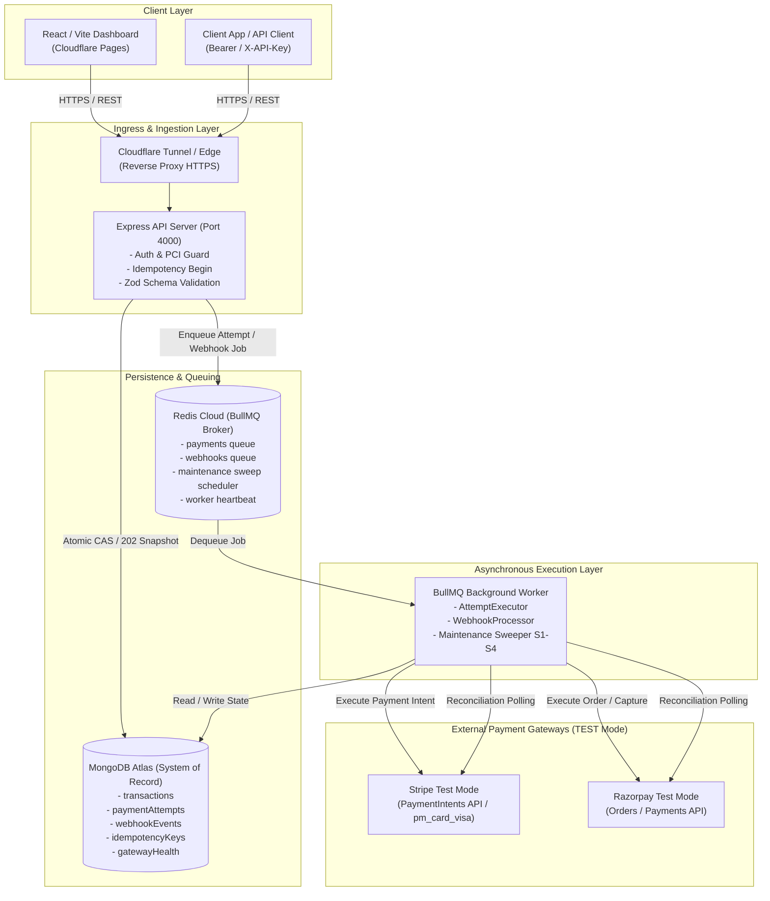
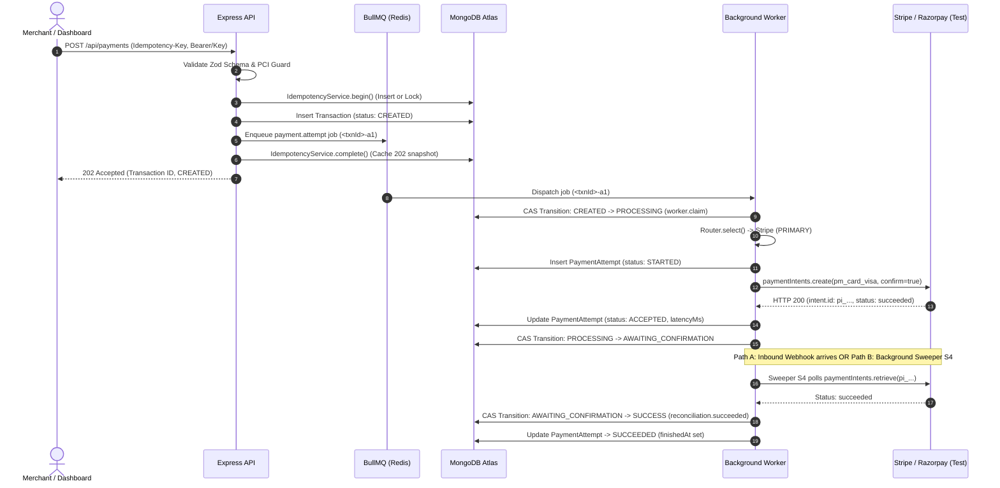

# PayRoute — Payment Orchestration & Webhook Reliability Engine

> **Reliable payments through intelligent multi-gateway orchestration, automated reconciliation, and resilient webhook intake.**

PayRoute is an interview-ready, open-source payment orchestration service designed to sit between merchant client applications and multiple payment gateways (**Stripe Test Mode** and **Razorpay Test Mode**). It eliminates single-point-of-failure risks, prevents duplicate charges under network partitions, handles transient outages through intelligent retries and circuit breakers, and enforces eventual consistency through asynchronous worker processing and background reconciliation.

---

## 1. Problem Statement & Architecture

### The Problem in Production Payments
Direct, single-gateway integrations suffer from critical vulnerabilities:
1. **Hard Gateway Outages**: If a single gateway goes down, checkout conversion drops to zero.
2. **Double-Charging on Ambiguous Timeouts**: Network drops during HTTP requests leave clients uncertain whether charges succeeded. Blind retries cause double charges.
3. **Flaky & Out-of-Order Webhooks**: Webhooks can arrive before API responses complete, be duplicated, or be dropped entirely by external networks.
4. **State Drift & Stuck Transactions**: Transactions can remain stuck in in-flight states indefinitely if webhook callbacks fail to reach the server.

### System Architecture Diagram



---

## 2. Core Reliability Mechanisms

### A. Two-Tier Idempotency (Zero Double-Charges)
1. **Client-Level Idempotency**:
   - Clients supply an `Idempotency-Key` header (8 to 128 characters matching `^[A-Za-z0-9_.:-]+$`).
   - The body is canonically hashed via SHA-256 (`requestHash`).
   - A unique MongoDB compound index on `(clientId, key)` enforces atomic insertion:
     - **Fresh Key**: Returns `NEW`, writes record, and proceeds.
     - **Identical Replay**: Returns `REPLAY` with the cached `202 Accepted` response snapshot and header `Idempotent-Replayed: true`.
     - **Reused Key with Different Body**: Throws `422 Unprocessable Entity` (`IDEMPOTENCY_KEY_REUSED`).
     - **Concurrent In-Flight Request**: Throws `409 Conflict` (`REQUEST_IN_PROGRESS`) with `retryable: true`.
2. **Gateway-Level Idempotency**:
   - Every external gateway call uses a deterministic idempotency key format:
     `pr_<transactionId>_<gateway>_g<generation>`
   - Gateway generations increment upon gateway failover to prevent cross-gateway collision.

### B. Deterministic & Explainable Routing
- **Primary Preference**: Prefers Stripe for supported currencies (`usd`, `inr`, `eur`, `gbp`).
- **Currency Gating**: Razorpay is filtered to INR-only transactions.
- **Circuit-Aware Routing**: Routes around gateways whose circuit breaker is in an `OPEN` state.
- **Failover**: When a primary gateway exhausts retries or trips its circuit, PayRoute automatically falls back to secondary eligible adapters (`FALLBACK_AFTER_EXHAUSTION`).

### C. Gateway Health & Circuit Breaker
- **Failure Window & Threshold**: Evaluates consecutive errors and rolling latency.
- **State Machine**:
  - `CLOSED`: Normal operation; all requests permitted.
  - `OPEN`: Trips after 5 consecutive failures; traffic immediately fails over to the next gateway without waiting for timeouts.
  - `HALF_OPEN`: After a 30-second cooldown, allows a single probe attempt. Successful probe closes the circuit; failed probe immediately re-opens it.

### D. Exponential Backoff & Jitter
- Handles transient errors (`TIMEOUT`, `RATE_LIMIT`, `SERVER_ERROR`).
- Delay formula: $\text{delay} = \min(\text{base} \times 2^{\text{attempt}-1}, 30000) \times (1 \pm \text{jitter})$.
- Fully respects gateway `Retry-After` headers if returned.

### E. Webhook Verification & Event Correlation
- **Raw Body Signature Verification**: Reconstructs raw UTF-8 payloads and verifies HMAC-SHA256 signatures before JSON parsing.
- **Deduplication**: Enforces unique `(gateway, eventId)` indexes in MongoDB.
- **State Immutability**: If a transaction has already completed (`SUCCESS`), subsequent duplicate webhooks verify payload correlation without altering `finishedAt` timestamps or re-incrementing attempt counters.

### F. Automated Background Reconciliation (Sweeper S1–S4)
Runs every 30 seconds via a BullMQ repeat scheduler:
- **S1 (Stuck Creations)**: Re-enqueues transactions stuck in `CREATED` > 60s.
- **S2 (Stuck Webhooks)**: Re-enqueues webhook events stuck in `RECEIVED` > 60s.
- **S3 (Stale Processing)**: Marks abandoned attempts `UNKNOWN` and schedules clean retries.
- **S4 (Gateway Reconciliation)**: For transactions in `AWAITING_CONFIRMATION` exceeding `RECONCILE_AFTER_MS` (default: 10 minutes), polls gateway APIs directly, checks final status, and promotes transactions to `SUCCESS` via `reconciliation.succeeded`.

---

## 3. Payment Request Lifecycle



---

## 4. Local Setup & Execution Commands

### Prerequisites
- Node.js 20+ (LTS)
- npm 10+
- Running MongoDB instance (local or MongoDB Atlas connection string)
- Running Redis instance (local or Redis Cloud connection string)

### 1. Repository Installation
```bash
# Clone the repository
git clone https://github.com/bhagyshree-10/PayRoute.git
cd PayRoute

# Install all monorepo workspace dependencies
npm install
```

### 2. Environment Configuration
Create a `.env` file in the project root based on `.env.example`:
```bash
cp .env.example .env
```

Set the required configuration parameters using placeholders:
```env
# --- Application ---
NODE_ENV=development
PORT=4000
FRONTEND_URL=http://localhost:5173,https://payroute-dashboard.pages.dev,https://387ee966.payroute-dashboard.pages.dev
LOG_LEVEL=info

# --- Persistence ---
MONGODB_URI=mongodb+srv://<username>:<password>@<cluster-host>/?appName=PayRoute
MONGODB_DB=payroute
REDIS_URL=redis://<username>:<password>@<redis-host>:<port>

# --- Stripe (TEST MODE ONLY) ---
STRIPE_SECRET_KEY=sk_test_<your_stripe_test_key>
STRIPE_WEBHOOK_SECRET=whsec_<your_stripe_webhook_secret>

# --- Razorpay (TEST MODE ONLY) ---
RAZORPAY_KEY_ID=rzp_test_<your_razorpay_key_id>
RAZORPAY_KEY_SECRET=<your_razorpay_key_secret>
RAZORPAY_WEBHOOK_SECRET=<your_razorpay_webhook_secret>

# --- Reliability & Timeouts ---
PRIMARY_GATEWAY=stripe
GATEWAY_TIMEOUT_MS=8000
CIRCUIT_BREAKER_THRESHOLD=5
CIRCUIT_BREAKER_TIMEOUT_MS=30000
RECONCILE_AFTER_MS=600000

# --- Auth ---
JWT_SECRET=<at_least_32_random_characters_long_secret>
JWT_EXPIRES_IN=8h
ADMIN_SEED_EMAIL=admin@example.com
ADMIN_SEED_PASSWORD=<your_admin_password>
```

### 3. Database Initialization & Seeding
Populate initial MongoDB collections, indexes, demo API keys, and admin account:
```bash
npm run seed -w backend
```

### 4. Running Services Locally

#### Option A: One-Click Startup & Shutdown (Windows Recommended)
Automated root launchers manage service lifecycles with health checks, duplicate process prevention, and dynamic link generation:
- **Start Services**: Double-click [`START-PAYROUTE.bat`](START-PAYROUTE.bat) (or run `scripts/start-payroute.ps1`). Starts the Express API (`http://localhost:4000`), BullMQ worker, and Cloudflare Quick Tunnel in separate visibly titled console windows, verifies `/api/health`, and generates the ready-to-click dynamic dashboard link.
- **Stop Services**: Double-click [`STOP-PAYROUTE.bat`](STOP-PAYROUTE.bat) (or run `scripts/stop-payroute.ps1`). Cleanly terminates only PayRoute processes (process on port 4000, `worker.ts`, and `cloudflared.exe` on port 4000) and frees port 4000.

#### Option B: Run Individual Workspaces (Recommended for Debugging)
Open separate terminal tabs:
```bash
# Terminal 1: Express API Server (Port 4000)
npm run dev -w backend

# Terminal 2: BullMQ Background Worker
npm run dev:worker -w backend

# Terminal 3: React / Vite Dashboard (Port 5173)
npm run dev -w frontend
```

#### Option C: Run All Workspaces Concurrently
```bash
npm run dev
```

#### Option D: Run via Docker Compose
```bash
docker compose up --build
```

---

## 5. Verification & Testing

### Automated Quality Checks
All automated test suites and TypeScript checks pass without errors:

```bash
# Run strict TypeScript build across monorepo workspaces
npm run typecheck

# Run full Vitest unit and integration test suite
npm test
```

### Test Suite Coverage Matrix (150/150 Passing Tests across 18 Test Suites)
| Test Suite | Tests | Scope & Assertions |
| :--- | :---: | :--- |
| `paymentValidation.test.ts` | 3 | Schema bounds, currency normalization, PCI Guard raw PAN/CVV detection |
| `idempotencyService.test.ts`| 4 | `NEW` insert, identical `REPLAY` 202, payload `CONFLICT` 409, in-flight `IN_PROGRESS` |
| `router.test.ts` | 4 | Primary selection, circuit fallback, currency eligibility (INR/USD), exhaustion |
| `circuitBreaker.test.ts` | 4 | `CLOSED` ➔ `OPEN` ➔ `HALF_OPEN` ➔ `CLOSED` state transitions & probe permits |
| `backoff.test.ts` | 3 | Exponential delay scaling (1s, 2s, 4s), $\pm 20\%$ jitter bounds, 30s ceiling |
| `classify.test.ts` | 5 | Error classification (`TRANSIENT`, `TERMINAL`, `AUTH`) & retryability |
| `stateMachine.test.ts` | 2 | Monotonic guarded Compare-and-Swap status transitions |
| `webhooks.test.ts` | 3 | HMAC-SHA256 signature verification, tampered payload rejection, missing headers |
| `webhookCorrelation.test.ts`| 47 | End-to-end webhook correlation, immutable `finishedAt`, duplicate charge safety |
| `webhookLookup.test.ts` | 10 | MongoDB domain ID lookups, BullMQ queue deduplication, orphan transitions |
| `attemptLifecycle.test.ts` | 16 | Attempt state transitions, timeline labeling, `attemptCount` safety |
| `repairHistoricalAttempts.test.ts` | 13 | Sweeper S1–S4 orphan repairs without modifying valid finished records |
| `apiEndpoints.test.ts` | 7 | Auth requirements (401), missing idempotency keys (400), health checks |
| `auth.test.ts` | 3 | JWT verification, token expiration bounds, password comparison |
| `hash.test.ts` | 2 | SHA-256 idempotency key hashing, payload canonization |
| `RouteTrace.test.tsx` | 1 | Frontend route trace visualization and badge rendering |
| `client.test.ts` | 18 | Dynamic `?api=` resolution, HTTPS enforcement, host whitelisting, credential isolation, 401 handling |

### Live End-to-End Verification (Manual & Non-Mocked)
- **Live Test Payment**: Transaction `txn_01M5XV1JV52FEBP9NPQSEK90H3` (Amount: ₹499.00 INR) was initiated through the public Cloudflare Pages dashboard.
- **Gateway Dispatch**: BullMQ worker dispatched the call to Stripe Test Mode with `pm_card_visa`. Stripe created PaymentIntent `pi_3UV2JsF8v6d32i832nJXDXlM` in `1454 ms`.
- **Automatic Eventual Consistency**: After the 10-minute `RECONCILE_AFTER_MS` window elapsed, the BullMQ background sweeper polled Stripe directly, observed `succeeded`, and promoted the transaction to **`SUCCESS`** with timeline event `reconciliation.succeeded`.

---

## 6. Live Demo Deployment Architecture (₹0 Budget)

To demonstrate the full dashboard while adhering to a strict ₹0 hosting budget, PayRoute uses a hybrid deployment model:

```
[ Public Internet ]
        │
        ├──► Cloudflare Pages (Global Edge Static CDN)
        │    Canonical URL: https://payroute-dashboard.pages.dev
        │    Preview URL:   https://387ee966.payroute-dashboard.pages.dev
        │    (SPA Routing handled via frontend/public/_redirects: /* /index.html 200)
        │
        └──► Cloudflare Quick Tunnel (cloudflared.exe)
             Tunnel Endpoint: https://<active-session>.trycloudflare.com/api
                    │
                    ▼ (Local Reverse Proxy Bridge)
             [ Local Host Environment ]
             ├── Express API Server (Port 4000)
             ├── BullMQ Background Worker
             ├── MongoDB Atlas (Managed Cloud M0 Tier)
             └── Redis Cloud (Managed Ephemeral Cache)
```

### Runtime Dynamic API Resolution (`?api=`)
Cloudflare Quick Tunnels (`*.trycloudflare.com`) are ephemeral free sessions that assign a new random subdomain upon each restart. To prevent rebuilding and re-uploading the frontend on every session, PayRoute implements **Runtime Dynamic API Resolution**:
- **Usage**: When `START-PAYROUTE.bat` runs, it detects the active tunnel and outputs a ready-to-click dynamic link:
  ```text
  https://payroute-dashboard.pages.dev/?api=https://<active-tunnel>.trycloudflare.com/api
  ```
- **Security & Validation Guardrails**:
  - **HTTPS Only**: Remote APIs must strictly use HTTPS; non-HTTPS remote URLs are rejected.
  - **Host Whitelist**: Restricts remote targets to trusted domains (`*.trycloudflare.com`, `*.pages.dev`, `*.ngrok-free.app`, `localhost`).
  - **Path Normalization**: Validates that target paths are strictly root or `/api`, rejecting unexpected deep paths.
  - **Credential Isolation**: If a different API host is passed via `?api=`, stored authentication tokens are cleared immediately (`setToken(null)`) so existing JWT credentials are never forwarded to a newly introduced host.
  - **Persistence**: Validated URLs persist in browser `sessionStorage` (`payroute_api_url`) for seamless tab navigation.

> [!NOTE]
> **Ephemeral Tunnel & Host Machine Limitation**: The API, BullMQ worker, and payment gateways execute on the local developer machine via Cloudflare Quick Tunnel. Quick Tunnels are temporary sessions that de-register upon process exit or disconnect. For permanent 24/7 cloud uptime independent of local hardware, deploy the provided Docker containers to cloud container platforms (see [DEPLOYMENT.md](DEPLOYMENT.md)).

---

## 7. Security & Safeguards

1. **PCI Guard**: The API actively parses and rejects incoming payloads containing raw credit card numbers (PANs) or CVVs in body fields or metadata.
2. **Live Credential Lockout**: The Zod configuration schema unconditionally aborts startup if production Stripe (`sk_live_`) or Razorpay (`rzp_live_`) credentials are detected.
3. **Scoped Authentication**: Merchant operations require an `X-API-Key` hashed via SHA-256; admin operations require cryptographically signed JWT Bearer tokens with strict 8-hour expiry.
4. **Strict CORS Whitelisting**: Dynamic origin evaluation allows only exact, pre-approved HTTPS domains (zero wildcard `*` allowed).

---

## 8. Known Limitations & Production Roadmap

1. **External Gateway Webhook Delivery**: While webhook signature verification and payload correlation are 100% verified via automated integration tests, live webhook delivery from Stripe's external cloud servers requires registering the tunnel URL in the Stripe Developer Dashboard (or running `stripe listen`).
2. **Uptime & High Availability**: Because the API and BullMQ worker run on local hardware via Cloudflare Tunnel for demo purposes, 24/7 production SLA is not claimed.
3. **Production Cloud Migration**: For permanent 24/7 uptime, deploy the provided Docker containers to cloud container platforms (see [DEPLOYMENT.md](file:///c:/Users/Acer/Desktop/PayRoute/DEPLOYMENT.md)).
